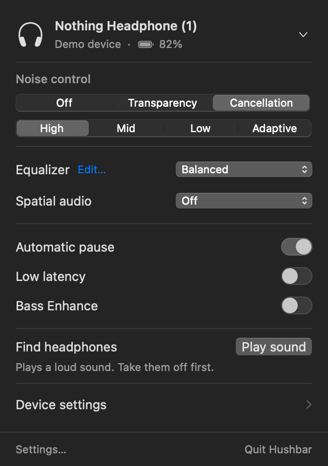
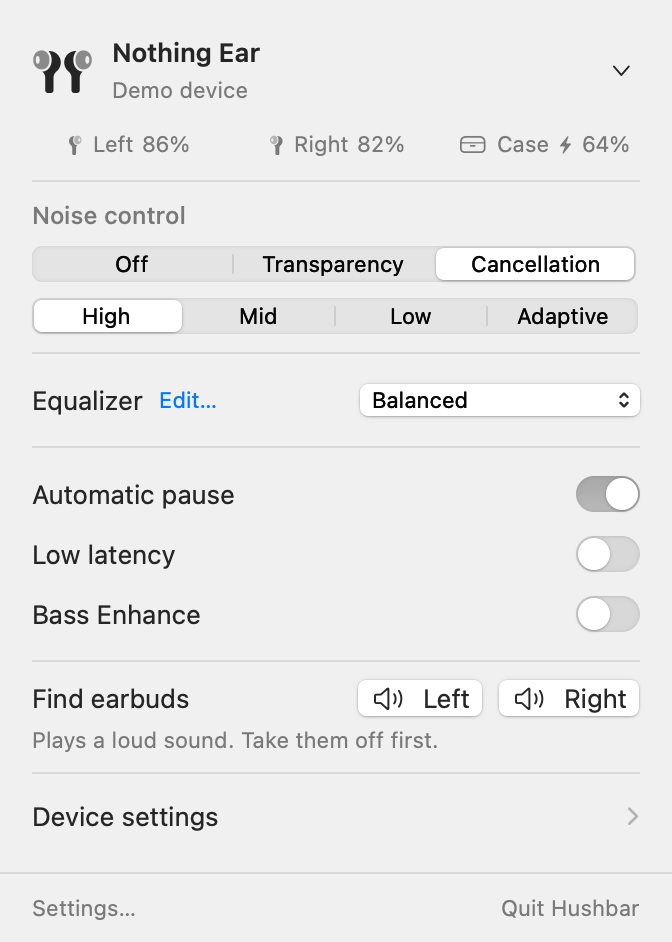
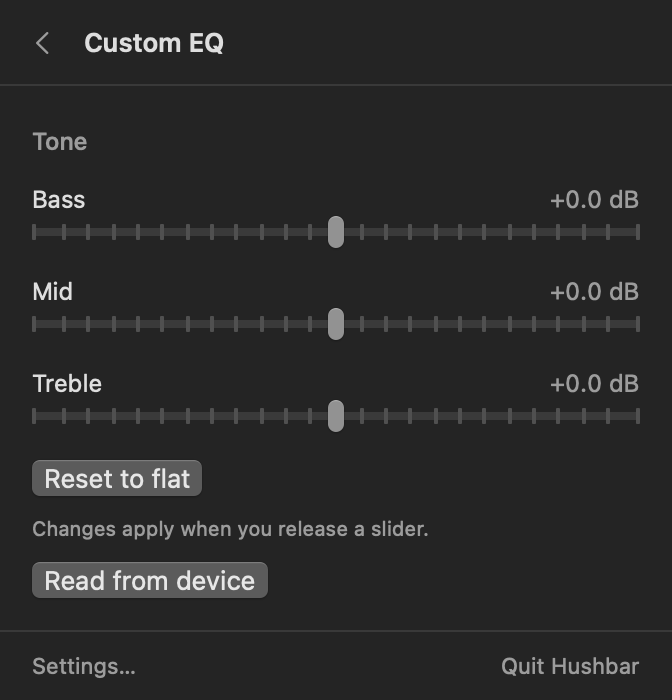
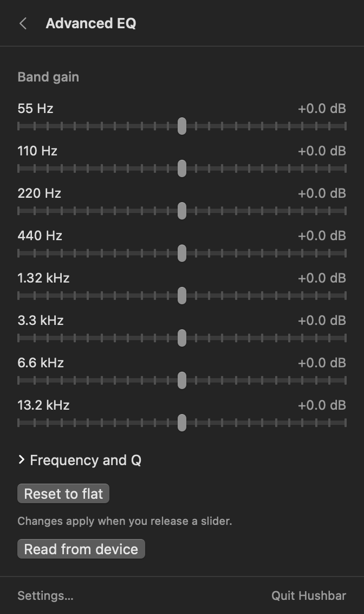
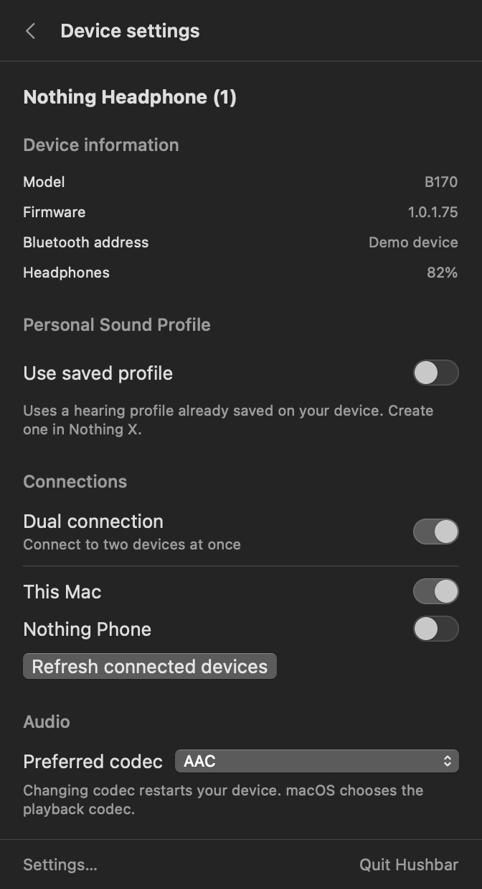
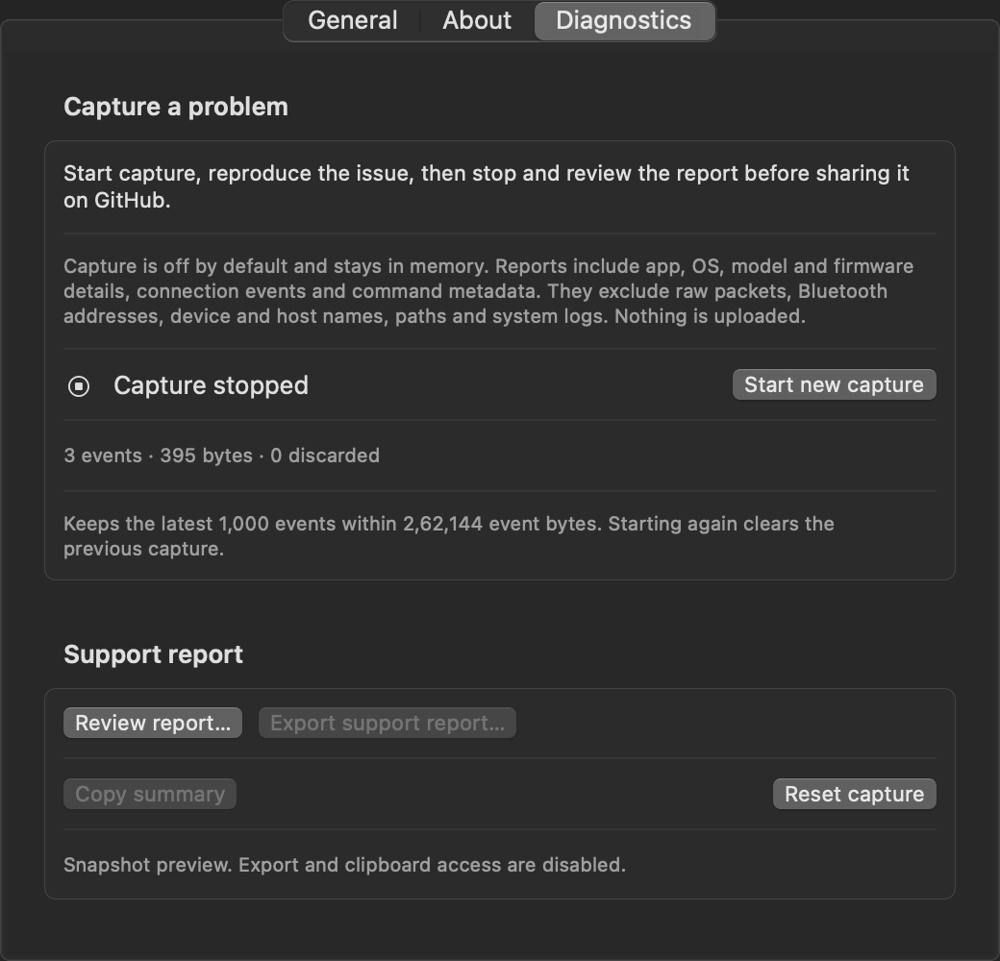

# Hushbar

Control your Nothing and CMF headphones from the macOS menu bar. Check battery levels, change noise cancellation, adjust EQ and manage device settings in a native macOS app.

## Screenshots

Shown with demo data.

| Headphone (1), dark appearance | Nothing Ear, light appearance |
| --- | --- |
|  |  |

| Custom EQ | Advanced EQ |
| --- | --- |
|  |  |

| Device settings | Diagnostics |
| --- | --- |
|  |  |

## Build and run

Requires macOS 14 or later, Swift 6 or later and [Bun](https://bun.sh) for repository checks.

```sh
git clone https://github.com/aaditagrawal/hushbar.git
cd hushbar
scripts/check.sh
scripts/test.sh
scripts/build-app.sh
open dist/Hushbar.app
```

Pair your device in macOS Bluetooth settings, then grant Hushbar Bluetooth access. Local builds are ad-hoc signed and aren't notarized.

To try the app without hardware, quit Hushbar and run `dist/Hushbar.app/Contents/MacOS/Hushbar --demo=B170`. Use `--demo=B171` for Nothing Ear.

## Compatibility

Nothing Headphone (1), firmware 1.0.1.81, has been tested. Other devices haven't been tested. EQ writes and Find sound remain unverified.

Controls vary by model and firmware. Gesture remapping and firmware updates aren't supported.

<details>
<summary>Device catalogue</summary>

<!-- catalogue:start -->

| Device | Model codes |
| --- | --- |
| Buds Pro | `B163` |
| CMF Buds | `B168` |
| CMF Buds 2 | `B179`, `B197` |
| CMF Buds 2 Plus | `B184` |
| CMF Buds 2a | `B185` |
| CMF Buds Pro 2 | `B172`, `B187`, `B195` |
| CMF Clip Pro | `B189` |
| CMF Headphone Pro | `B175` |
| Ear (2) | `B155` |
| Ear (Stick) | `B157` |
| Neckband Pro | `B164` |
| Nothing Ear | `B171` |
| Nothing ear (1) | `B181` |
| Nothing Ear (3) | `B173`, `B201` |
| Nothing Ear (3a) | `B190` |
| Nothing Ear (a) | `B162`, `B183` |
| Nothing Ear (open) | `B174` |
| Nothing Headphone (1) | `B170` |
| Nothing Headphone (1) Pro | `B192` |
| Nothing Headphone (a) | `B186`, `B198` |

<!-- catalogue:end -->

</details>

## Report a problem

In Settings, open Diagnostics, start a capture, reproduce the problem, then stop, review and export the report. Attach it to an [issue](https://github.com/aaditagrawal/hushbar/issues/new/choose) with your model, firmware, macOS version and the steps to reproduce.

Reports contain connection and command metadata, without raw packets, personal device names or Bluetooth addresses. Review reports and screenshots before sharing. For security issues, use [private reporting](https://github.com/aaditagrawal/hushbar/security/advisories/new) if available, or request a private contact route without posting sensitive details.

## Privacy

Hushbar works locally over Bluetooth, with no accounts, analytics or automatic uploads. Preferences stay on your Mac. Diagnostic capture is opt-in and stays in memory until you export it.

## Development

See [AGENTS.md](AGENTS.md) for package boundaries and test commands, and [protocol notes](docs/PROTOCOL.md) for wire formats and device research.

## Credits and licence

[AGPL-3.0](LICENSE). Based on [ear-web](https://github.com/radiance-project/ear-web) by RapidZapper, Bendix and contributors.

Hushbar is unofficial and isn't affiliated with Nothing Technology. Nothing and CMF product names belong to their respective owners.

<details>
<summary>Upstream permission</summary>

> Nothing Technology Limited or any of its affiliates, subsidiaries, or related entities (collectively, “Nothing Technology”) is a valid licensee and can use this app for any purpose, including commercial purposes, without compensation to the developers of this app. Nothing Technology is not required to comply with the terms of the GNU General Public License v3.0.

</details>
